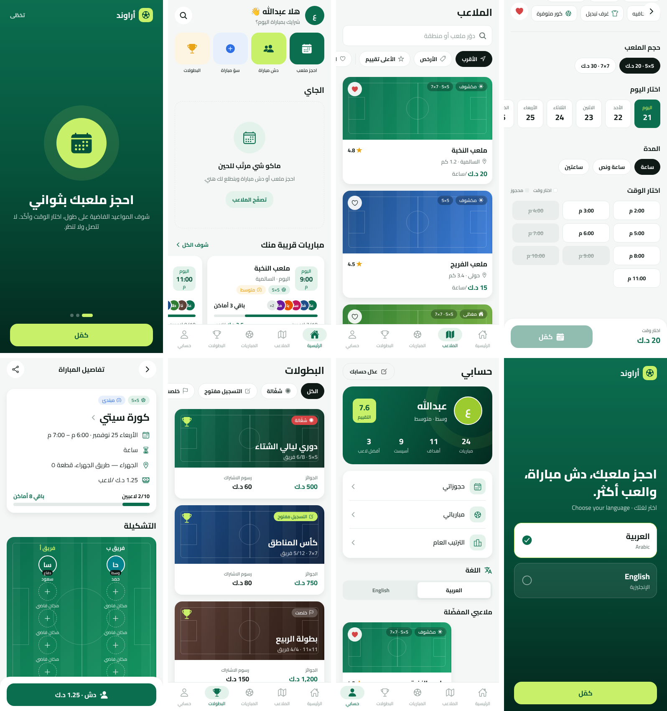
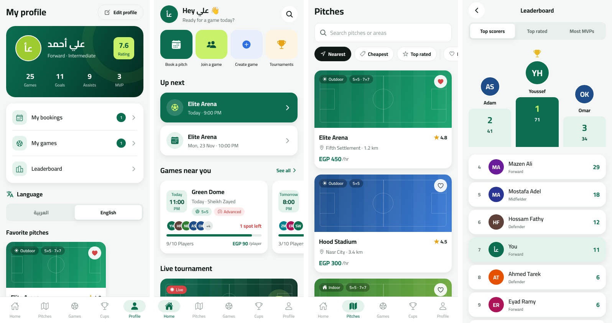

# Around | أراوند ⚽

A bilingual (Arabic / English) football community app built with **React Native + Expo**:
book pitches, join or create pickup games, compete in tournaments, and track your stats.

تطبيق مجتمع كرة قدم بالكويت بلغتين (عربي باللهجة الكويتية / إنجليزي): احجز ملعبك، دش مباراة أو سوّ مباراة، شارك بالبطولات وتابع إحصائياتك.




## Features | المميزات

- **Onboarding**: language picker, intro slides, player card setup (position and level).
- **Pitch booking**: search, sort (nearest / cheapest / top rated), filters (size, indoor, favorites), live slot
  availability over 14 days, duration and pitch size, booking summary, confirmation, and cancellation.
- **Pickup games**: discover by day and level, spots-left progress, visual lineup on a pitch, join / leave,
  invite via share, and creating a game with an automatic per-player price split.
- **Tournaments**: live, open and finished; standings table, fixtures and results, team registration.
- **Profile**: FIFA-style player card, my bookings, my games, leaderboard (scorers / rating / MVPs),
  favorite pitches, edit profile, and a language switch that applies instantly with no restart.
- **UX**: full RTL layout in Arabic, Cairo font for both scripts, haptics, press animations, bottom sheets,
  toasts, empty states, confirmation sheets for destructive actions, and data saved on the device.

## Run | التشغيل

```bash
npm install
npx expo start          # then scan the QR code with Expo Go, or press i / a / w
npx expo start --web    # run in the browser
npm run typecheck
```

## Structure

```
src/app/            Expo Router screens (tabs, pitch/[id], match/[id], match/create, tournament/[id], ...)
src/components/     UI kit (direction-aware), cards, sheets, toasts
src/i18n/           strings (ar / en) and date / money formatting
src/store/          app state (context + reducer, persisted with AsyncStorage)
src/data/           types and demo data
```

> Data is demo data stored on the device. Connecting a backend (e.g. Supabase) for real accounts, payments
> and notifications is the next step.
